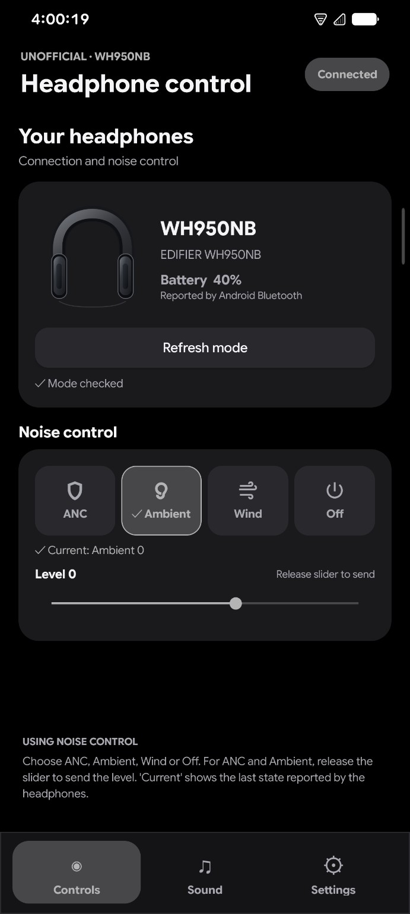
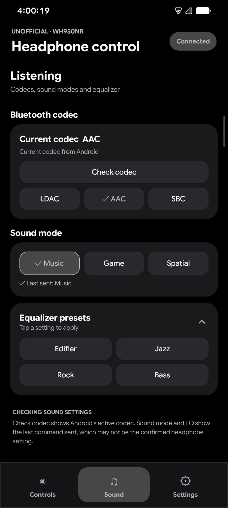
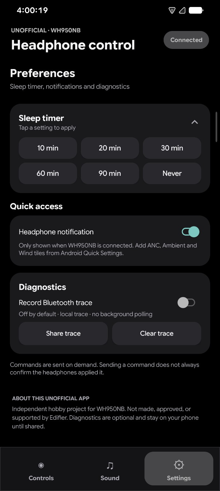
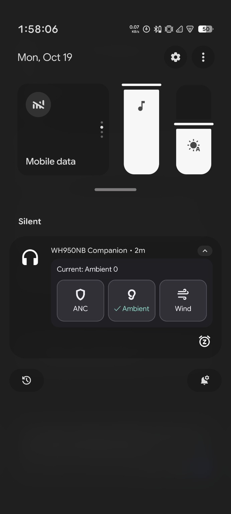

# WH950NB Companion

**An independent, unofficial Android companion app for Edifier WH950NB headphones.**

Control listening modes, check headphone status, and access sound settings from one app.

**v0.3.21 Beta 1** · **Open source (MIT)**

### [Download Beta 1 APK](https://github.com/Riku-lgtm43/WH950NB-Companion/releases/download/v0.3.21-beta.1/WH950NB-Companion-v0_3_21-beta1.apk) · [View release details](https://github.com/Riku-lgtm43/WH950NB-Companion/releases/tag/v0.3.21-beta.1)

> **Unofficial beta:** This project is not made, affiliated with, endorsed by, or supported by Edifier. Experimental software is provided as-is; updates and support are not guaranteed. See [Legal notices](LEGAL.md) and the [MIT license](LICENSE).

## Before you install

- **Headphones:** Edifier WH950NB.
- **Root access:** Not required for the main headphone features. Shizuku is optional and is used for supported advanced codec controls.
- **Verified setup:** Rooted Android 16 with root-mode Shizuku. This is a tested configuration, not a root requirement. Other configurations have not yet been verified.
- **Bluetooth:** Pair your headphones in Android's Bluetooth settings and grant the app's requested Bluetooth permissions.
- **Codec controls:** Shizuku must be running with suitable privileges for supported LDAC / AAC / SBC requests. Availability depends on your device and configuration.

## What you can do

| Area | Controls and information |
| --- | --- |
| **Controls** | Headphone connection and battery status; ANC, Ambient, Wind, and Off modes with supported levels |
| **Sound** | Bluetooth codec status and supported codec requests; Music, Game, and Spatial modes; EQ presets |
| **Settings** | Sleep timer, optional connection-dependent notification, and local opt-in diagnostics |
| **Quick access** | Quick Settings tiles and feedback for pending or confirmed commands |

**EQ note:** EQ presets may not take effect in Spatial mode. Switch to Music mode before adjusting EQ.

## See the app

The app uses three bottom tabs: **Controls · Sound · Settings**.

| Controls | Sound |
| --- | --- |
|  |  |

| Settings (sleep timer expanded) | Notification |
| --- | --- |
|  |  |

*Screenshots are from one Android 16 setup. Appearance may vary by device and ROM.*

## Install the beta

1. [Download the signed Beta 1 APK](https://github.com/Riku-lgtm43/WH950NB-Companion/releases/download/v0.3.21-beta.1/WH950NB-Companion-v0_3_21-beta1.apk).
2. Install the APK on your Android device.
3. Pair your WH950NB headphones in Android Bluetooth settings.
4. Open WH950NB Companion and grant the requested permissions.
5. For supported codec controls, start Shizuku with suitable privileges and grant the app access.

**What to expect:** Connection and battery information depend on your connected headphones. Codec requests may be unavailable or unsupported on some configurations. The app provides status feedback for pending or confirmed commands.

## Build from source using Termux

The project is written in Java and can be compiled directly in Termux.

```sh
git clone https://github.com/Riku-lgtm43/WH950NB-Companion.git
cd WH950NB-Companion
bash setup_termux.sh
bash test_protocol.sh
BUILD_VARIANT=debug bash build.sh
```

If you downloaded this ZIP, extract it and run the scripts from the extracted folder. GitHub-generated source ZIPs use a `WH950NB-Companion-*` folder name.

- The build uses an **Android API 34** framework and downloads Shizuku dependencies during initial setup. Internet access is required for initial setup, not requested by the app.
- The development APK is generated at `build/WH950NB-Companion-v0_3_21-debug.apk` and may also be copied to Downloads when storage access is configured.
- Protocol checks are **not** a substitute for testing with physical headphones.
- **Do not publish a development keystore or distribute a debug APK as a public release build.**

For details, read the [build and signing guide](docs/BUILD_AND_RELEASE.md).

## Documentation and project files

| Resource | Purpose |
| --- | --- |
| [Release notes](RELEASE_NOTES.md) | What's included in Beta 1 |
| [Security and privacy](SECURITY.md) | Permissions, diagnostics, and security reporting |
| [Legal notices](LEGAL.md) | Unofficial status and legal limitations |
| [Third-party notices](THIRD_PARTY_NOTICES.md) | Dependency and vector-icon notices |
| [Contributing](CONTRIBUTING.md) | How to contribute |
| [Documentation](docs/) | Bluetooth flow, protocol provenance, testing, and release process |
| `src/`, `res/`, `assets/` | Java source, Android resources, and generic illustration |
| `build.sh`, `setup_termux.sh`, `align_apk.py` | Termux build tools |
| `tests/`, `test_protocol.sh` | Protocol checks |

**Maintainer:** [XRiku / Riku-lgtm43](https://github.com/Riku-lgtm43) · **Release tag:** `v0.3.21-beta.1`
